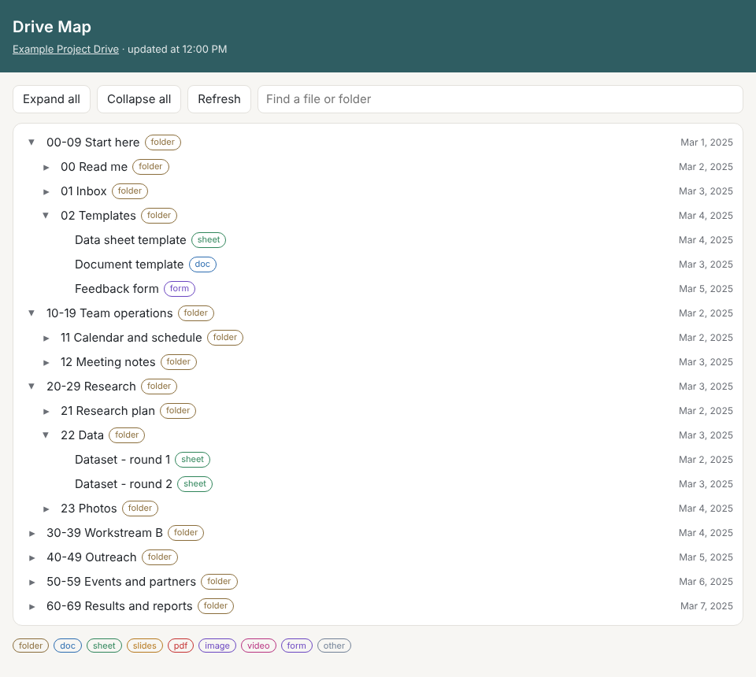

# Student Project Ops with AI

[Português](README.md) · **English**

How I used an AI agent and Google Apps Script to restructure the operations of a university extension project: its shared Drive, its access rules and its operating model.



> Names, folders, IDs and sample data in this repository are fictitious. The code is a cleaned-up public version of what ran in production. The result counts are real.

## Problem

A university extension project with about 30 student members runs on a shared Google Drive and a group chat. Students rotate every year; only a few people stay. In practice:

- Files were spread over several legacy folders owned by individual students. When a student leaves, their files can leave with them.
- There was no naming rule, so the same document existed in several versions and newcomers could not find things.
- Access was granted person by person, with no clear line between what members edit, what they only read, and what is coordination-only.
- Most coordination work flowed through one person, and decisions lived only in the chat history.

## Solution

As a student member, I led this restructuring and used Claude as an agent for reading, research, drafting and code. Every change to the live Drive went through a dry run and my approval.

1. **Status brief from the chat.** The agent read the full group-chat export and produced a structured brief (open items, roles, rules, timeline) that every later session used as memory. → [prompt 01](prompts/01-chat-export-to-status-brief.md)
2. **Operating structure.** From the project's real constraints (turnover, attrition, parallel workstreams), a function-based structure with a constraint → answer table and the proposal's own weakest assumptions. → [prompt 02](prompts/02-org-structure-from-constraints.md)
3. **Research-backed Drive taxonomy.** A comparison of folder methods from primary sources, ending in numbered ranges (Johnny.Decimal style) split into *active*, *archive* and *restricted* areas, a naming convention and a permission matrix by role. → [prompt 03](prompts/03-drive-taxonomy-research.md)
4. **Value analysis before changing a live system.** Five alternative structures scored on weighted criteria with vetoes; the winning option was tested on the real Drive before rollout. → [prompt 04](prompts/04-value-analysis-decision-matrix.md), [scoring script](tools/decision_matrix.py)
5. **Migration toolkit (Apps Script).** Inventory, ownership audit, idempotent permissions, moves that leave a shortcut at the origin, renames from a plan, and a folder-ID map. Every mutating function is a dry run by default. → [code](apps-script/drive-migration-toolkit)
6. **Tools for members.** A one-click anonymous feedback-form template, and a **Drive Map** web app (built, not yet deployed) that shows the whole folder tree with search and file-type tags, using batched Drive API calls and a per-user cache. → [form](apps-script/feedback-form-template), [Drive Map](apps-script/drive-map-webapp)

How the pieces fit together: [docs/architecture.md](docs/architecture.md).

## Tools

- **Claude** (Anthropic) as the agent: long-document reading, web research, drafting, code generation and debugging, with Google Drive and Docs connectors and code execution.
- **Google Apps Script** (V8) with the Drive API v3 (advanced service and REST), Forms, Spreadsheet, Properties and Cache services.
- **Python** with Playwright and Pillow to render the web app locally with fake data and strip image metadata.
- **Methods:** Johnny.Decimal and PARA for the taxonomy, ISO 8601 dates in file names, value analysis (function analysis) with weighted criteria and vetoes.

## Result

Counted from the scripts' execution logs:

| Output | Number |
|---|---|
| Items inventoried in the largest legacy folder before migrating | 559 |
| Folders in the new structure | 62 |
| Items renamed to the new convention | 124 |
| Items moved to the project account's ownership | 24 of 24; final audit: 0 remaining |
| Accounts (members and coordinators) given access by role in one idempotent run | 33, with no notification e-mails |

The new Drive and its quick guide were shared with all members, and the form template was used to build the project's feedback form.

**Outcomes (to be measured):** time for a newcomer to find 3 files, share of new files that follow the naming rule, inbox backlog, self-reported ease of finding files, and weekly users of the Drive Map once it is deployed. The method for each is in [docs/measurement-plan.md](docs/measurement-plan.md).

## What this proves

| Skill | Evidence in this repo |
|---|---|
| **Prompt engineering and agent orchestration** | Four reusable prompts with fixed output contracts, human decision points, "verified vs assumption" labels and injection guards; a multi-session workflow where a knowledge base and session hand-offs act as the agent's memory ([architecture](docs/architecture.md)). |
| **Automation that people rely on** | The public version of a migration toolkit that ran on a live Drive used by the whole team: dry run by default, idempotent, logged, no hard-coded IDs. |
| **Tools used by other people** | The restructured Drive and quick guide (shared with every member), the feedback-form template, and the Drive Map web app (built; deployment in progress). |
| **Measurable result** | Output numbers above, taken from logs; a written plan with targets for the outcomes not yet measured. |

## Repository map

```
apps-script/
  drive-map-webapp/          folder-tree web app with live data (Code.gs, Index.html)
  drive-migration-toolkit/   inventory, audit, permissions, move, rename
  feedback-form-template/    one-click anonymous feedback form
prompts/                     the four prompt templates
tools/
  decision_matrix.py         weighted scoring with vetoes
  render_demo.py             renders the web app with fake data for the screenshot
sample-data/                 fictitious inputs for the tools
docs/                        architecture, measurement plan, images
```

## Run it

**Decision matrix** (Python 3.9+, no dependencies):

```bash
python tools/decision_matrix.py sample-data/alternatives.json
```

**Demo screenshot** (fake data, no Google account):

```bash
pip install -r requirements.txt && playwright install chromium
python tools/render_demo.py
```

**Apps Script projects:** create a project in the Apps Script editor, copy the files of one folder, set the Script Properties listed at the top of each `.gs` file, and run the dry run first. Each folder's `appsscript.json` declares the minimum scopes it needs.

## License

MIT. See [LICENSE](LICENSE).
