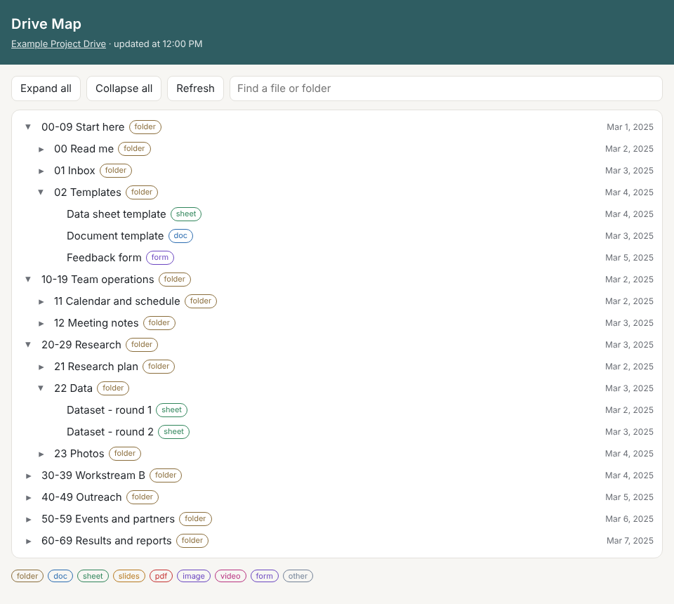

# Operações de um projeto de extensão com IA

**Português** · [English](README.en.md)

Como usei um agente de IA e Google Apps Script para reorganizar a operação de um projeto de extensão universitária: o Drive compartilhado, as regras de acesso e o modelo de funcionamento.



> Nomes, pastas, IDs e dados de exemplo deste repositório são fictícios. O código é uma versão pública e limpa do que rodou em produção. As contagens do resultado são reais.

## Em 1 minuto

- **O problema:** cerca de 30 estudantes dividiam um Drive sem regra de nome, de pasta ou de acesso, e os arquivos saíam junto com quem saía do projeto.
- **O que eu fiz:** como integrante do projeto, liderei a reestruturação. Usei o Claude para ler, pesquisar, redigir e programar. Escolhi a nova estrutura com uma matriz de critérios com pesos e vetos, e migrei o Drive com scripts que simulam antes de executar.
- **O resultado (contado nos registros dos scripts):** 559 itens inventariados, 124 renomeados, 62 pastas na nova estrutura e 33 contas com acesso por papel, numa única execução.
- **Como rodar:** `python tools/decision_matrix.py sample-data/alternatives.json` mostra a matriz de decisão com dados fictícios.
- **Limites:** medi as entregas, ainda não o efeito no dia a dia (tempo para achar um arquivo, uso do padrão de nomes). O plano de medição está em [docs/measurement-plan.md](docs/measurement-plan.md), em inglês.

## Problema

Um projeto de extensão com cerca de 30 estudantes funciona num Google Drive compartilhado e num grupo de mensagens. Os estudantes mudam todo ano e poucas pessoas ficam. Na prática:

- Os arquivos estavam espalhados em pastas antigas, de propriedade de cada estudante. Quando alguém sai, os arquivos podem sair junto.
- Não havia regra de nome. O mesmo documento existia em várias versões e quem chegava não achava as coisas.
- O acesso era dado pessoa por pessoa, sem separar o que os integrantes editam, o que só leem e o que é só da coordenação.
- A maior parte da coordenação passava por uma pessoa, e as decisões ficavam só no histórico do grupo.

## Solução

Como integrante do projeto, liderei esta reestruturação e usei o Claude como agente para leitura, pesquisa, redação e código. Toda mudança no Drive real passou por uma simulação e pela minha aprovação.

1. **Resumo da situação a partir do grupo.** O agente leu a exportação completa da conversa e montou um resumo estruturado (pendências, papéis, regras, linha do tempo), usado como memória nas sessões seguintes. → [prompt 01](prompts/01-chat-export-to-status-brief.md)
2. **Estrutura de funcionamento.** A partir das restrições reais do projeto (rotatividade, desistências, frentes em paralelo), uma estrutura por função, com uma tabela "restrição → resposta" e as premissas mais frágeis da própria proposta. → [prompt 02](prompts/02-org-structure-from-constraints.md)
3. **Organização do Drive com base em pesquisa.** Comparação de métodos de pastas em fontes primárias. O resultado: faixas numeradas (estilo Johnny.Decimal) divididas em áreas *ativa*, *arquivo* e *restrita*, um padrão de nomes e uma matriz de permissões por papel. → [prompt 03](prompts/03-drive-taxonomy-research.md)
4. **Análise de valor antes de mexer num sistema em uso.** Cinco estruturas alternativas receberam notas em critérios com pesos e vetos. A vencedora foi testada no Drive real antes da implantação. → [prompt 04](prompts/04-value-analysis-decision-matrix.md), [script das notas](tools/decision_matrix.py)
5. **Ferramentas de migração (Apps Script).** Inventário, auditoria de propriedade, permissões que podem rodar de novo sem duplicar, mover deixando um atalho na origem, renomear a partir de um plano e um mapa de IDs das pastas. Toda função que altera algo roda primeiro como simulação. → [código](apps-script/drive-migration-toolkit)
6. **Ferramentas para os integrantes.** Um modelo de formulário anônimo de feedback criado com um clique e o web app **Mapa do Drive** (construído, ainda não implantado), que mostra a árvore de pastas com busca e etiquetas por tipo de arquivo. → [formulário](apps-script/feedback-form-template), [Mapa do Drive](apps-script/drive-map-webapp)

Como as peças se encaixam: [docs/architecture.md](docs/architecture.md) (em inglês).

## Ferramentas

- **Claude** (Anthropic) como agente: leitura de documentos longos, pesquisa na web, redação, geração e correção de código, com conectores do Google Drive e Docs.
- **Google Apps Script** (V8) com a API do Drive v3 e os serviços de Formulários, Planilhas, Propriedades e Cache.
- **Python** com Playwright e Pillow para gerar a imagem do web app com dados falsos e remover metadados.
- **Métodos:** Johnny.Decimal e PARA para as pastas, datas ISO 8601 nos nomes, análise de valor com critérios ponderados e vetos.

## Resultado

Contado nos registros de execução dos scripts:

| Entrega | Número |
|---|---|
| Itens inventariados na maior pasta antiga, antes de migrar | 559 |
| Pastas na nova estrutura | 62 |
| Itens renomeados para o novo padrão | 124 |
| Itens transferidos para a conta do projeto | 24 de 24; auditoria final: 0 restantes |
| Contas (integrantes e coordenação) com acesso por papel, numa única execução | 33, sem e-mails de notificação |

O novo Drive e o guia rápido foram compartilhados com todos os integrantes. O modelo de formulário foi usado para criar o formulário de feedback do projeto.

**Efeitos (a medir):** tempo para alguém novo achar 3 arquivos, parcela de arquivos novos que segue o padrão de nomes, fila da pasta de entrada, facilidade de achar arquivos (declarada) e usuários semanais do Mapa do Drive depois de implantado. O método de cada um está em [docs/measurement-plan.md](docs/measurement-plan.md).

## O que este repositório mostra

| Habilidade | Evidência |
|---|---|
| **Escrever prompts e coordenar agentes** | Quatro prompts reutilizáveis com formato de saída fixo, pontos de decisão humana, rótulos "verificado" e "premissa" e proteção contra instruções escondidas. Um fluxo em várias sessões em que uma base de conhecimento serve de memória do agente ([arquitetura](docs/architecture.md)). |
| **Automação em que outras pessoas confiam** | A versão pública das ferramentas de migração que rodaram num Drive em uso por toda a equipe: simulação por padrão, registro de tudo e nenhum ID fixo no código. |
| **Ferramentas usadas por outras pessoas** | O Drive reestruturado e o guia rápido (compartilhados com todos), o modelo de formulário e o Mapa do Drive (construído; implantação em andamento). |
| **Resultado medido** | Os números acima, tirados dos registros, e um plano escrito com metas para o que ainda falta medir. |

## Mapa do repositório

```
apps-script/
  drive-map-webapp/          web app da árvore de pastas (Code.gs, Index.html)
  drive-migration-toolkit/   inventário, auditoria, permissões, mover, renomear
  feedback-form-template/    formulário anônimo de feedback com um clique
prompts/                     os quatro modelos de prompt
tools/
  decision_matrix.py         notas ponderadas com vetos
  render_demo.py             gera a imagem do web app com dados falsos
sample-data/                 entradas fictícias para as ferramentas
docs/                        arquitetura, plano de medição, imagens
```

## Como rodar

**Matriz de decisão** (Python 3.9 ou mais novo, sem dependências):

```bash
python tools/decision_matrix.py sample-data/alternatives.json
```

**Imagem de demonstração** (dados falsos, sem conta Google):

```bash
pip install -r requirements.txt && playwright install chromium
python tools/render_demo.py
```

**Projetos de Apps Script:** crie um projeto no editor do Apps Script, copie os arquivos de uma pasta, preencha as Propriedades do script listadas no topo de cada arquivo `.gs` e rode a simulação primeiro. O `appsscript.json` de cada pasta declara as permissões mínimas necessárias.

## Licença

MIT. Veja [LICENSE](LICENSE).
