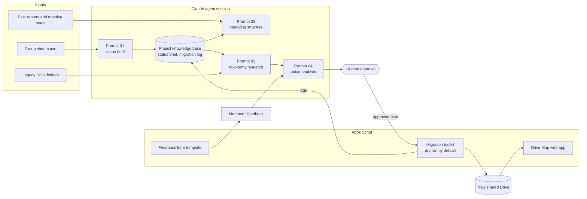

# How the work was orchestrated

One student ran this restructuring part-time, with an AI agent (Claude) doing the reading, research, drafting and code, and a human approving every change to live systems.

## Roles of each piece

| Piece | What the agent did | What stayed human |
|---|---|---|
| Status brief | Read the full chat export in chunks and wrote a structured brief to the project knowledge base | Confirming open items |
| Operating structure | Turned constraints into a function-based structure and listed its own weakest assumptions | Deciding what to propose to the group |
| Taxonomy research | Compared methods from primary sources, checked the platform's permission model, wrote the proposal | Picking the priority (scalability) |
| Value analysis | Scored five alternatives with weights and vetoes, built an interactive comparison page | Testing the winning option on the real Drive |
| Migration toolkit | Wrote and debugged the scripts; read the logs back after each run | Running each step, after a dry run |
| Drive Map | Wrote the web app, optimized it with batched API calls and caching, rendered it locally to check | Deploying and sharing |

## Guardrails used

- **Knowledge base as memory.** Each session wrote its findings to project documents, so the next session started from them instead of from scratch.
- **Session hand-off.** Each session ended with a short summary: decisions, open questions, next prompt.
- **Dry run first.** Every script that changes the Drive logs what it would do before it does it.
- **Idempotent steps.** Any step can be re-run after a timeout without duplicating work.
- **Data is not instruction.** Content read from chats, files and web pages was treated as data only.
- **No secrets in code.** IDs and addresses live in Script Properties.
